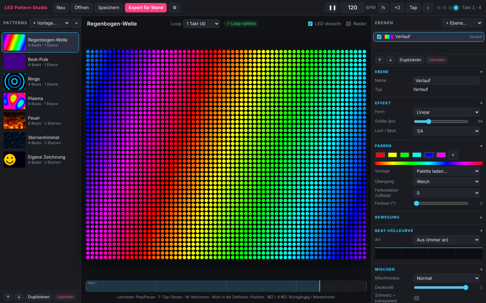

# LEDWall

Modulare LED-Wand aus kleinen 64 × 48-Pixel-Wänden.



```
   Mac: Pattern Studio  ──(.lwb-Bank)──►  Pico 2W  ──(Frames)──►  RP2040 Zero ─► Wand 1 (64×48)
                                         Takt/BPM              ├─► RP2040 Zero ─► Wand 2
                                                                └─► …
```

- **Pico 2W:** Zentrale. Er hält die Pattern-Bank, bestimmt BPM und Beat-Position und
  schickt jeder Wand, was sie zeigen soll.
- **RP2040 Zero** (einer pro Wand): steuert die Pixel seiner 64 × 48-Wand an.

## Inhalt

| Ordner | Inhalt |
|---|---|
| [`pattern-studio/`](pattern-studio/) | macOS-Editor zum Erstellen von Patterns mit Live-Vorschau und BPM-Vorschau |
| [`docs/lwb-format.md`](docs/lwb-format.md) | Dateiformat der exportierten Pattern-Bank und wie der 2W sie abspielt |

Die Firmware für den Pico 2W und die RP2040 Zeros folgt als Nächstes.
